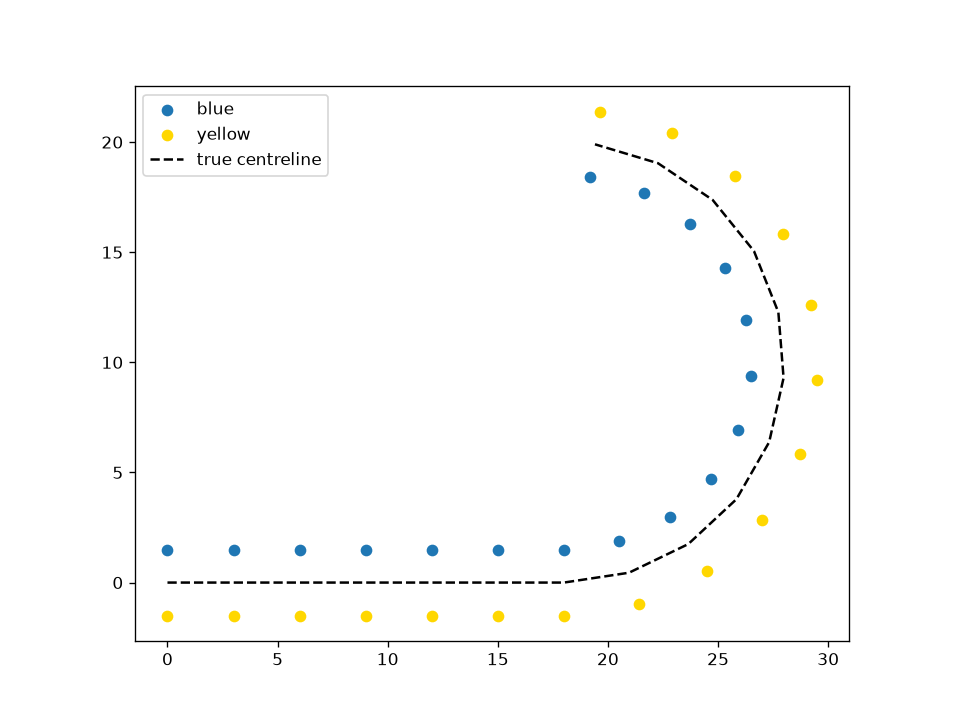
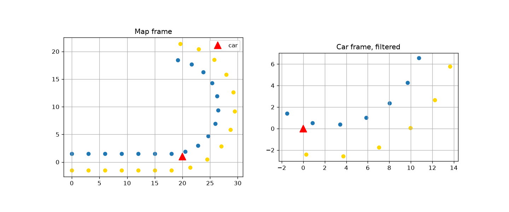
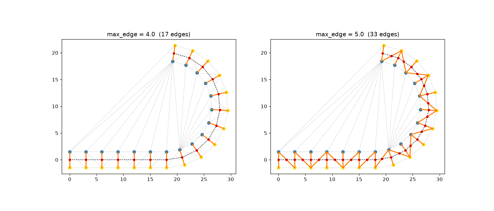
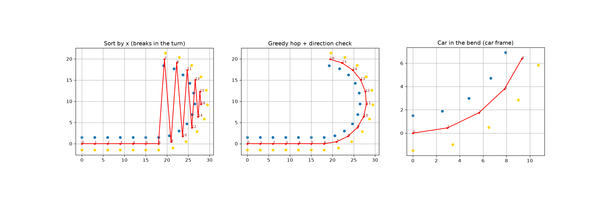

# Khonshu Path Planner

Khonshu is a Python path-planning project for the Strathmore University autonomous Formula Student car. It provides small, testable building blocks for working with cone observations, vehicle transforms, and an initial centreline estimate.

This repository is currently an algorithm and simulation prototype. It is not yet a ROS 2 node or an integrated EUFS Sim planner.

## Features

- Represent and generate blue/yellow cone observations.
- Generate a synthetic straight-and-left-turn track for development.
- Convert points and cone observations between map and car coordinates.
- Filter cone observations to a configurable region ahead of the vehicle.
- Build a Delaunay triangulation and find valid blue-yellow cone pairs.
- Estimate centreline points and track widths from matching cone pairs.
- Order centreline points using a direction-aware greedy search that follows bends and turns.

## Demo gallery

### Synthetic track

The synthetic track contains blue and yellow cone sides, plus the true centreline.



### Map and car frames

The transform demo shows the vehicle pose in the map frame and the cones in a filtered vehicle frame.



### Centreline triangulation

The triangulation demo uses Delaunay edges between blue and yellow cones to derive centreline midpoints.



### Ordered centreline

The centreline demo compares sorting by x with a greedy, heading-aware path builder. It also demonstrates planning from a car positioned partway through a turn.



## Installation

Requires Python 3.8 or newer.

```bash
python3 -m venv .venv
source .venv/bin/activate
python -m pip install --upgrade pip
python -m pip install -e .
```

For test dependencies:

```bash
python -m pip install -e ".[dev]"
```

## Run the demos

Each demo is headless and writes a PNG in the repository root:

```bash
python scripts/demo_track.py
python scripts/demo_transform.py
python scripts/demo_triangulation.py
python scripts/demo_centerline.py
```

Run all demos from the repository root.

## API examples

Generate a synthetic track:

```python
from planner.fake_tracks import straight_then_turn

cones, centreline = straight_then_turn(
    straight=18.0,
    radius=10.0,
    turn_deg=180.0,
    half_width=1.5,
)
```

`cones.blue` and `cones.yellow` are NumPy arrays shaped `(n, 2)`. `centreline` is the NumPy array of true track centre points in the same two-dimensional coordinate system.

Convert observations into the vehicle frame and retain nearby cones ahead:

```python
from planner.transforms import cones_to_car, filter_ahead

car_cones = cones_to_car(cones, car_xy=(20.0, 1.0), car_yaw=0.5)
nearby_cones = filter_ahead(
    car_cones,
    x_min=-2.0,
    x_max=15.0,
    y_max=8.0,
)
```

Estimate centreline midpoints and track widths:

```python
from planner.triangulation import triangulate, blue_yellow_edges

points, triangles = triangulate(cones)
edges = blue_yellow_edges(
    cones,
    min_edge=2.0,
    max_edge=4.0,
)

midpoints = edges.midpoints
track_widths = edges.widths
```

`Edges` also contains `blue_idx`, `yellow_idx`, and `midpoints`, which link each estimated centreline point to its paired blue and yellow cones.

Build an ordered centreline from the detected midpoints:

```python
from planner.triangulation import blue_yellow_edges
from planner.centerline import build_centerline

edges = blue_yellow_edges(cones)
path = build_centerline(
    edges,
    start=(0.0, 0.0),
    heading=(1.0, 0.0),
    max_hop=6.0,
    max_turn_deg=90.0,
)
```

`build_centerline` starts with the car position and greedily advances to nearby midpoints ahead of the current heading. This avoids the ordering problems that occur when a simple x-coordinate sort is used on a track containing bends. `order_by_x` remains available as a simple baseline; `order_greedy` can also be used directly when a list of midpoint coordinates is already available.

## Package layout

- `planner/cones.py`: `Cones` observation container.
- `planner/fake_tracks.py`: synthetic track generation.
- `planner/transforms.py`: coordinate transformations and filtering.
- `planner/triangulation.py`: Delaunay triangulation and blue-yellow matching.
- `planner/centerline.py`: heading-aware centreline ordering.
- `scripts/`: runnable demos.
- `tests/`: pytest coverage for synthetic tracks, transforms, and triangulation.

## Testing

```bash
python -m pytest
```

## Future integration

The next stage is to turn these building blocks into a complete planner and integrate it with ROS 2 and EUFS Sim. The intended pipeline is:

1. Consume cone detections and vehicle localisation.
2. Estimate the track centreline and boundaries.
3. Generate smooth waypoints.
4. Plan and validate a speed profile.
5. Publish a trajectory or control commands.
